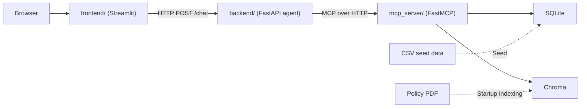

# Empório da Música Agent

## Product overview

Empório da Música is a fictional musical instrument store in Campo Grande, Brazil. Its support team receives recurring questions about products, prices, availability, promotions, orders, and store policies. This project provides a Portuguese (Brazil) chat assistant that answers from the store's operational data and policy manual.

## Implemented features

- A Streamlit chat with session history.
- A FastAPI agent that uses recent conversation history (10 messages by default), chooses store tools, and returns a validated answer status: `answered`, `partially_answered`, `not_answerable`, or `out_of_scope`.
- Product search with category, price, stock, sorting, and pagination; active promotion search; order lookup by numeric ID; and policy retrieval from the store manual.
- Answers grounded in tool results, including combined operational and policy questions. Requests that require a human decision or action are flagged in the response and UI. This is informational only.
- Read-only MCP tools usable by other MCP clients, plus offline API and tool tests and separate model-based evaluations.

## Architecture summary



The frontend keeps history in Streamlit session state and sends it to the backend. The backend loads the four tools from the MCP server at startup; it does not read SQLite or Chroma directly. The MCP server is the sole runtime reader of those stores. The six CSV files seed SQLite; conversations do not read CSVs. The policy PDF is the source for Chroma. The backend's `/health` endpoint becomes ready after its MCP tools load, and the MCP server's `/health` endpoint becomes ready after database validation and policy indexing.

## Install Docker and Docker Compose

Install Docker before running the application. Choose the official instructions for your system:

- **Windows (including WSL 2):** [Install Docker Desktop for Windows](https://docs.docker.com/desktop/setup/install/windows-install/).
- **macOS:** [Install Docker Desktop for Mac](https://docs.docker.com/desktop/setup/install/mac-install/).
- **Linux:** [Install Docker Engine](https://docs.docker.com/engine/install/) for your distribution, then [install the Docker Compose plugin](https://docs.docker.com/compose/install/linux/). [Docker Desktop for Linux](https://docs.docker.com/desktop/setup/install/linux/) is another option.

Docker Desktop includes Docker Engine, the Docker CLI, and Docker Compose. Start Docker Desktop or the Docker Engine service, then check that the CLI, Compose, and the engine are available:

```bash
docker --version
docker compose version
docker info
```

## Environment configuration

From the repository root, copy the template and fill in the three required OpenAI values before starting the services:

```bash
cp .env.example .env
```

Set `OPENAI_API_KEY`, `OPENAI_CHAT_MODEL` (a chat model that supports tool calling and structured output), and `OPENAI_EMBEDDING_MODEL` (the model for policy indexing and search). This version uses OpenAI for both chat and embeddings. Keep `.env` private; it is ignored by Git and excluded from the Docker build context. The Compose services receive the configured values through their environment entries.

| Setting | Purpose / default |
|---|---|
| `RAGAS_EVALUATOR_MODEL`, `RAGAS_EMBEDDING_MODEL` | OpenAI evaluator and embedding models used only when running the evaluations. Fill these in before evaluating. |
| `DATABASE_PATH`, `DATA_DIR` | Compose uses `/app/database/emporio.db` in the named `database` volume and CSVs from `/app/data`. |
| `POLICY_PDF_PATH`, `CHROMA_PERSIST_DIR`, `CHROMA_COLLECTION_NAME` | Compose reads the PDF from `/app/data/políticas_da_loja.pdf`, persists the index in the named `chroma` volume, and defaults to the `policy_manual` collection. |
| `RAG_TOP_K`, `RAG_MAX_CHUNK_CHARS`, `RAG_CHUNK_OVERLAP_CHARS` | Retrieval and chunk settings; defaults: `4`, `1200`, `150`. |
| `MCP_SERVER_HOST`, `MCP_SERVER_PORT` | MCP bind address and port; defaults: `0.0.0.0`, `8000`. |
| `MCP_SERVER_URL` | Backend's internal MCP endpoint in Compose: `http://mcp-server:8000/mcp`. |
| `BACKEND_PORT`, `BACKEND_URL` | API port (`8080`) and frontend's internal API URL in Compose: `http://backend:8080`. |
| `MAX_HISTORY_MESSAGES`, `LOG_LEVEL` | Backend history window (`10`) and log level (`INFO`). |

Use the default ports with Compose: its healthchecks target ports 8000, 8080, and 8501. Changing the embedding model, PDF, or chunk settings requires rebuilding the index as described below; changing the chat model or these inputs calls for a fresh evaluation.

## Run with Docker Compose

Run commands from the repository root. The CSVs are initial data for SQLite. Seed the database **before** starting the MCP server. On the first MCP startup, the server parses the policy PDF, embeds its chunks, and saves them in Chroma; subsequent starts reuse a ready collection. Indexing requires OpenAI access and can take longer than later starts.

With Docker, Compose, and the configured `.env` ready, build the image, seed SQLite, and start the frontend and its dependencies.

```bash
docker compose build
docker compose run --rm seed
docker compose up -d frontend
docker compose ps
```

The first startup indexes the manual automatically. `docker compose ps` shows health for `mcp-server`, `backend`, and `frontend`; allow time for the initial index before expecting all three to be healthy. Open <http://127.0.0.1:8501>. The MCP endpoint is available to other clients at <http://127.0.0.1:8000/mcp>; the backend API is internal to Compose.

Inspect runtime logs and stop the services with:

```bash
docker compose logs backend mcp-server
docker compose down
```

To restart while retaining the seeded database and ready Chroma index, run `docker compose up -d frontend` after `docker compose down`. After changing code, rebuild with `docker compose build` before starting again. After changing CSVs or the PDF, rebuild the image and recreate both generated volumes before reseeding and starting:

```bash
docker compose down -v
docker compose build
docker compose run --rm seed
docker compose up -d frontend
```

`docker compose down -v` removes the generated `database` and `chroma` volumes, including any local state in them. The same reset is required to force reindexing after changing the embedding model or chunk settings. A normal `docker compose down` preserves both volumes.

## Test execution

The API and MCP tool tests are offline and do not require an OpenAI key. With `uv` installed, run:

```bash
uv run pytest
uv lock --check
uv run ruff format --check .
uv run ruff check .
uv run mypy frontend backend mcp_server
```

## Implemented tools

All four tools are exposed by the FastMCP server over streamable HTTP at `/mcp` and are read-only.

| Tool | What it returns |
|---|---|
| `search_products` | Paginated catalog matches filtered by query, category, price range, stock, and sort order; includes total and `has_more`. |
| `list_active_promotions` | Paginated active promotions, optionally filtered by product text or category, with original price, discount, computed promotional price, and availability. |
| `get_order_status` | One order by numeric `order_id`, including status, items, payment, total, tracking code, and delivery estimate when present. |
| `query_policy` | The most relevant policy-manual chunks for a question, with chunk ID, section, and source text; it does not summarize the chunks. |

## Vector RAG strategy

At MCP startup, PyMuPDF4LLM converts the whole text-based policy PDF into continuous Markdown. The parser checks its tables against the PDF and reconstructs only tables whose column counts differ. Markdown headers define sections; long sections are split with controlled overlap, and each chunk keeps a stable ID and section path. OpenAI embeddings are stored locally in a persistent Chroma collection. For each policy query, the server embeds the question and performs similarity search for the top `RAG_TOP_K` chunks (default 4). The agent receives these chunks as tool output. A ready collection is reused without re-embedding its document chunks; the implementation does not detect source or configuration changes automatically.

## Evaluation

The hand-written [Ragas dataset](evaluation/ragas_dataset.jsonl) has 12 answerable policy questions with reference answers covering hours, payment, shipping, returns, warranties, and promotions. `scripts/evaluate.py` runs the agent, scores the exact contexts it received from `query_policy`, and records per-question and aggregate scores in [the Ragas report](evaluation/ragas_report.json). The evaluator LLM is an OpenAI model selected by `RAGAS_EVALUATOR_MODEL`; Answer Relevancy uses the OpenAI embedding model selected by `RAGAS_EMBEDDING_MODEL`. The report does not store model IDs; the models used are listed in [Model choices](#model-choices) and must stay fixed when comparing runs.

| Metric | What it measures | Initial target | Achieved |
|---|---|---:|---:|
| Faithfulness | Share of answer claims supported by the retrieved contexts | ≥ 0.85 | 0.9896 |
| Answer Relevancy | Whether the answer directly addresses the question | ≥ 0.80 | 0.8015 |
| Context Recall | Share of the reference facts covered by the retrieved contexts | ≥ 0.80 | 1.0000 |
| Context Precision | Whether relevant chunks are ranked above irrelevant ones | ≥ 0.75 | 0.8889 |
| RAGAS Score (project composite) | Harmonic mean of the four metrics above | ≥ 0.75 | 0.9126 |

These targets are initial, uncalibrated project references, not official Ragas thresholds. RAGAS Score is a composite calculated by this project, not a standard Ragas metric. Scores are model-based and the per-question results matter: for example, the payment-installment question scored 0.6379 on Answer Relevancy, while the shipping-to-other-cities question scored 0.5000 on Context Precision. The aggregate alone does not show these weaknesses.

The [golden dataset](evaluation/golden_dataset.jsonl) contains 8 operational cases covering product search, promotions, and order lookup. The [golden report](evaluation/golden_report.json) records a 100% pass rate for each check—expected tools, forbidden tools, arguments, answer status, required facts, and groundedness—and 8/8 cases passed all checks. The first four checks are deterministic; the last two use the evaluator LLM selected by `RAGAS_EVALUATOR_MODEL`. This dataset does not measure policy-only, combined, unanswerable, or out-of-scope questions.

The evaluation scripts use OpenAI and overwrite their respective reports when run. Rerun the evaluations after changing prompts, retrieval, or models; recreate the policy index first when its source or embeddings change.

## Technical decisions

### Agent framework and approach

The agent uses **tool calling** with LangChain's `create_agent` and an OpenAI chat model. Store questions fall into two kinds: exact operational data, such as prices, stock, promotions and orders, and rules written in the policy manual. The approach is therefore hybrid: operational data is queried through typed tools, and the manual is queried through vector RAG, also exposed as a tool. For each question, the model decides whether to consult data, policies, both or no source.

The four tools live in a separate MCP server built with FastMCP and reach the agent through LangChain's MCP adapter. This separation lets other agents reuse the same tools without going through the backend. The final answer is structured output validated by Pydantic, so abstention and human handoff are handled through fields rather than phrases.

`create_agent` was chosen because the flow is a standard tool-calling loop, with no conditional steps that would justify a custom LangGraph graph. Text-to-SQL and SQL agents were ruled out for the reasons described in [Structured data access](#structured-data-access-csvs).

### Model choices

- **Agent chat model — `gpt-6-luna`:** the cheapest current OpenAI model that supports tool calling and structured output. The task is narrow, with four typed tools, and the volume is low.
- **Retrieval embedding model — `text-embedding-3-small`:** the manual is small (26 chunks), so cost is negligible and the smaller model should be enough.
- **Ragas evaluator model — `gpt-6.1-sol`:** the judge should be stronger than, and different from, the agent being evaluated, to produce reliable scores and avoid self-evaluation bias. Since the evaluation runs only a few times, the extra cost is small. It stays fixed so results remain comparable across runs.
- **Ragas embedding model — `text-embedding-3-small`:** used only by Answer Relevancy to measure similarity. It is kept separate from the retrieval model so the measuring stick does not change when retrieval changes.

### Interaction interface

The interface is a Streamlit web chat, chosen for how simple it is to build. The focus of the challenge is an agent that works correctly, and Streamlit provides ready-made chat components, such as the message input, history, spinner and error messages, that assemble the interface in a few lines of Python, without HTML, CSS, JavaScript or a frontend framework. Almost all of the effort therefore goes into the agent, not the UI.

The interface shows only the agent's answer or a generic error message, with no technical details. It just sends messages over HTTP to the FastAPI service that runs the agent, so the agent logic stays outside the UI and the API can also be used directly. A CLI was left out of scope.

### Conversation history persistence

History is kept only for the browser session, because it matters for the experience: right after a search, the user may ask "and which one is the cheapest?", and the agent needs the previous context to resolve the reference. The frontend stores the session messages and sends them with each question; the backend is stateless and passes only the 10 most recent messages to the agent, a configurable value. This window limits token usage and keeps long conversations from increasing cost and latency without control.

History is not persisted beyond the session: reloading the page starts a new conversation, and different sessions do not share messages. For a support prototype, this simplicity is enough. Cross-session persistence and progressive summarization of long conversations are left as future work.

### Data processing

The CSVs are validated before being loaded into SQLite: headers, types, allowed values, dates, specification JSON, duplicate IDs, foreign keys, negative values and invalid percentages. Loading runs in a single transaction, into a temporary file, and replaces the existing database only when everything is valid. On any error, the process reports the file and line, and the previous database is preserved.

During loading, the system generates normalized versions of names and descriptions, without accents and in lowercase, so that searches such as "violão" and "violao" return the same products. Monetary values are handled as decimals rounded to two places, avoiding floating-point errors in the promotional price calculation. The customers table is loaded only to guarantee order integrity and is never exposed to the agent.

In the policy PDF, headers, footers and page numbers are removed during the conversion to Markdown. These elements repeat on every page and contain no rules; if kept, they would appear in the middle of sections, polluting chunks and embeddings. The conversion produces a continuous document, so sections that span pages stay whole.

### Operational data persistence

The CSV files are used only as seed data to populate a local SQLite database. At runtime, the agent does not access the database: it calls the MCP server tools, which query SQLite in read-only mode through typed repositories and parameterized queries, with no generic SQL. This approach brings the project closer to a real-world scenario, in which the data would live in an operational database or API, while keeping the solution simple. Replacing SQLite only requires a new repository adapter, without changing the tool contracts or the agent.

### Structured data access (CSVs)

Structured data is accessed through **domain tools with typed parameters**, backed by repositories and parameterized queries with SQLAlchemy Core. The LLM chooses the operation and fills in arguments validated by Pydantic, but it has no direct access to the schema and cannot generate free-form SQL.

This approach fits because the agent serves known operational needs, such as searching products, applying filters, looking up orders and listing promotions. Users of this service do not need to explore the database, build reports or run arbitrary statistical analyses. Compared with Text-to-SQL, exploratory agents or a generic DSL, the tools offer less flexibility, but they are more predictable, secure, auditable and easier to test, and they also prevent access to unauthorized data.

The limitation is that new categories of questions may require creating or extending a tool. This decision should be revisited only if real usage shows a relevant volume of legitimate queries that cannot be expressed by the current contracts.

### Search pagination

Product search and promotion lookup use pagination, a common practice in systems that may return large volumes of data, to avoid sending long lists to the model and to prevent results from being silently truncated. Each call returns a limited number of items, together with `total` and `has_more`, making it possible to tell when other matching results exist. This decision keeps context usage predictable and avoids presenting a partial list as if it were complete.

### Locally persisted vector store

The policy manual is indexed into a locally persisted Chroma collection. Indexing happens at MCP server startup only when the collection does not exist yet or is incomplete; when the collection is already ready, it is reused, so document embeddings are not regenerated on every restart. Changes to the PDF, the embedding model or the chunking configuration are not detected automatically: in those cases, the index must be rebuilt as described in [Run with Docker Compose](#run-with-docker-compose). There is no reranker or lexical search in this version.

### Structural chunking

The manual is split by its section and subsection headings. This approach was chosen because the questions handled by the agent usually match the document's own units, such as payments, warranty, delivery or returns. A fixed character-based split could separate a rule from its conditions, exceptions or deadlines, producing incomplete chunks and less representative embeddings.

Small sections are kept whole; only sections above the maximum size are split, with each part repeating the original section heading. In the current manual, no section exceeds this limit, so each chunk corresponds to a complete section. The Ragas evaluation showed no loss of context recall, so the default maximum size and overlap were kept.

### PDF to Markdown conversion

The manual is converted into a single continuous Markdown document during indexing, using the PDF as the canonical source. Headings, lists and tables are preserved, so the structure used by chunking comes from the parser, without a custom parser for the whole document. The only specific treatment is table validation: when the number of extracted columns differs from the table geometry in the PDF, the table is rebuilt from its cells, which fixes the opening hours table.

### Prompt strategy

A template separates store persona, tool-routing guidance, source-grounding rules, abstention, and the answer contract. Policy facts enter through `query_policy` output instead of being copied into the system prompt, so a manual update only requires reindexing, not a prompt change.

### Abstention and handoff to human support

The agent uses structured output to recognize when the sources do not support a complete answer, avoiding made-up information. Each answer is classified as answered, partially answered, not answerable or out of scope. When a request requires a decision or operation that is not available to the agent, it also flags the need for human support and states the reason. In this version, this handoff is informational only.

## Known limitations and future work

The items below are not part of this version; with more time, they would be the next steps:

- **CI/CD:** automate linting, type checking, tests, critical-case evaluation, image build and scanning, registry publishing, and per-environment deployment.
- **Observability:** adopt structured traces and metrics for latency, cost, and tool calls, correlated by session.
- **Resilience:** configure timeouts, controlled retries, rate limiting, and a maximum tool-call budget.
- **Index lifecycle:** add content and configuration fingerprints, versioned collections, embedding reuse, and automatic detection of stale indexes.
- **Model abstraction:** introduce factories compatible with LangChain's `BaseChatModel` and `Embeddings` if another provider is concretely needed.
- **Auditable answers:** include section and page citations in answers based on the policy manual.
- **Evaluation:** expand the golden dataset.
- **Conflicting source data:** the policy manual lists two WhatsApp numbers, (67) 3341-4444 and (67) 3321-4500, and spells the store e-mail with and without an accent. The agent does not reconcile these conflicts and, depending on the sections retrieved, may return only one of the values. The next step would be a prompt rule to report each conflicting value with its source section instead of choosing one

## AI coding assistants

I primarily used AI, specifically Claude Opus 5.5, during the planning phase. After defining the technology stack, project structure, and technical approach myself, I provided these decisions along with the project requirements and asked AI to organize the work into development tasks.

I reviewed and refined the proposed tasks to align them with the project’s scope and goals. Architectural decisions, scope prioritization, and final validation remained my responsibility.
